  

  

  <h2> 🛠️ Tech Stacks </h2>

  <h4>Backend</h4>
  

  <h4>Database</h4>
  

  <h4>Infra / DevOps</h4>
  

  <h4>AI</h4>
  

  <h4>Tools</h4>
  

  <h2> 🧑‍💻 Contact me </h2>
  
  

  <h2> 👾 Contributions </h2>
  <picture>
    <source media="(prefers-color-scheme: dark)" srcset="https://raw.githubusercontent.com/hunhee99/hunhee99/output/pacman-contribution-graph-dark.svg">
    <source media="(prefers-color-scheme: light)" srcset="https://raw.githubusercontent.com/hunhee99/hunhee99/output/pacman-contribution-graph.svg">
    
  </picture>

